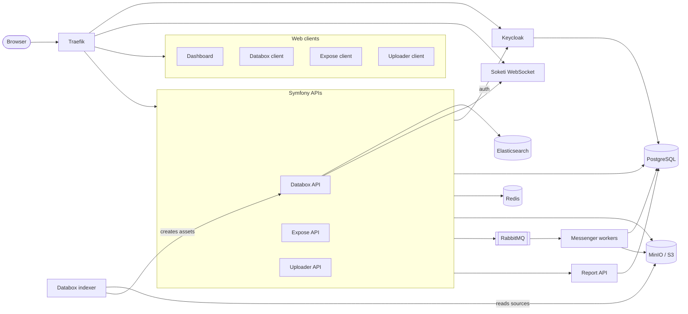

<div align="center">


**The open-source DAM for modern organizations**

[Website](https://www.phrasea.com) · [Documentation](https://docs.phrasea.com) · [Docker Hub](https://hub.docker.com/u/alchemyfr) · [Helm charts](https://github.com/alchemy-fr/phrasea-helm-charts) · [Report a bug](https://github.com/alchemy-fr/phrasea/issues/new/choose)

[](./LICENSE)
[](https://github.com/alchemy-fr/phrasea/releases)
[](https://github.com/alchemy-fr/phrasea/actions/workflows/quick.yaml)
[](https://github.com/alchemy-fr/phrasea/actions/workflows/ci.yaml)
[](https://github.com/alchemy-fr/phrasea/commits/next)
[](./CONTRIBUTING.md)

</div>

<!-- TODO: product screenshot (databox client), e.g. doc/assets/screenshot.png -->

## About

Phrasea is an open-source Digital Asset Management (DAM) platform for organizations that need
control over their digital assets. It offers fine-grained permissions for users and groups,
integrations with external tools and AI providers, and runs as SaaS, on-premise or in hybrid mode.
Phrasea is developed by [Alchemy](https://www.phrasea.com) as the successor of Phraseanet.

## Features

### Databox: the DAM core

- Workspaces, nested collections, stories and baskets, with access control on workspaces,
  collections and assets.
- Metadata read from the source files on ingest, configurable attributes, single and batch
  editing, import templates.
- Renditions defined per workspace, file versions, file analyzers, and workflows run on ingest.
- Collaboration: sharing links (permanent or time-limited), visual annotations, discussions with
  mentions, notifications.

### Search

- Search backed by Elasticsearch: full text, facets, sorting, suggestions, saved searches.
- Conditions written in [AQL, the Asset Query Language](./doc/tech/Databox/aql.md), shared by
  the API, saved searches and the condition builder.
- Results laid out on a map by geo point attributes ([map](./doc/tech/Databox/map.md)).

### Expose: publication

- Publications of assets on the web, with download, gallery and lightbox layouts.
- Protection by password or authentication, terms of use, direct URLs and slugs.
- Publications synchronized from Databox baskets.

### Uploader: ingestion

- Upload by file selector, drag and drop, clipboard or URL, with multipart upload of large files.
- Targets per user group, each with its metadata form described in JSON Schema
  ([form configuration](./doc/tech/Uploader/form_config.md)).
- Delivery of the uploaded batches to Databox, to Phraseanet (push or pull mode) or to a
  third-party endpoint.

### Dashboard

- A single entry point listing the Phrasea services available to the user.

### Integrations

Databox [integrations](./doc/tech/Databox/integration/01_integrations.md) run in workflows or
from user actions:

- AWS Rekognition, AWS Transcribe, AWS Translate
- Happyscribe (transcription and subtitles)
- Remove.bg (background removal)
- Toast UI Photo Editor
- Phraseanet renditions synchronization
- Moderation, watermark, Blurhash, renditions, file analyzers
- Outbound webhooks

## Architecture

Each application is a Symfony API plus a React client. Long-running work goes through RabbitMQ to
Symfony Messenger workers.



A detailed diagram is available in
[`doc/tech/Deployment/technical-architecture.svg`](./doc/tech/Deployment/technical-architecture.svg).

## Quick start

This starts the whole stack locally with Docker Compose, on the default domain `phrasea.local`.

Prerequisites:

- Linux with Docker 28.5.2+ and Docker Compose 2.40.3+
- About 6 CPU cores and 16 GB of RAM (indicative, see
  [prerequisites](./doc/tech/Deployment/01_prerequisite.md))
- [mkcert](https://github.com/FiloSottile/mkcert) for local HTTPS certificates
- Ports 80 and 443 free (see [Changing ports](./doc/tech/01_setup.md#changing-ports))

Clone the repository:

```bash
git clone https://github.com/alchemy-fr/phrasea.git
cd phrasea
```

Change every default password or secret of `.env` (their values start with `__CHANGE_ME_`), by
overriding them in a `.env.local` file at the root of the project. Then define the `dc` function
in your `~/.bashrc` or `~/.zshrc`, so that Docker Compose loads `.env.local`:

```bash
function dc() {
    if [ -f .env.local ]; then
        docker compose --env-file=.env.local --env-file=.env --env-file=.env.local "$@"
    else
        docker compose "$@"
    fi
}
```

Create the local certificate authority (once per machine) and the certificate of `*.phrasea.local`:

```bash
mkcert -install
bin/dev/make-cert.sh
```

Add the local domains to `/etc/hosts`:

```bash
sudo bin/dev/append-etc-hosts.sh
```

Set up the databases and the initial configuration:

```bash
bin/setup.sh
```

Start the stack:

```bash
dc up -d
```

Then open:

| Application | URL                             |
| ----------- | ------------------------------- |
| Dashboard   | https://dashboard.phrasea.local |
| Databox     | https://databox.phrasea.local   |
| Expose      | https://expose.phrasea.local    |
| Uploader    | https://uploader.phrasea.local  |
| Keycloak    | https://keycloak.phrasea.local  |

Sign in with the user `phrasea-admin` and the password set in `DEFAULT_ADMIN_PASSWORD`.

The images are pulled from Docker Hub; run `bin/build.sh` first to build them from the sources.
See the [setup guide](./doc/tech/01_setup.md) (Let's Encrypt, periodic tasks, fixtures, logs) and the
[development setup](./doc/tech/02_dev.md) for the rest.

## Deployment

- **Docker Compose**: follow the [setup guide](./doc/tech/01_setup.md).
- **Kubernetes**: use the [Helm charts](https://github.com/alchemy-fr/phrasea-helm-charts).
- **Images**: published on Docker Hub as [`alchemyfr/ps-*`](https://hub.docker.com/u/alchemyfr)
  (`ps-databox-api-php`, `ps-databox-client`, `ps-expose-api-php`, `ps-uploader-api-php`,
  `ps-dashboard`, `ps-keycloak`, `ps-configurator`, `ps-report-api`, …).

Infrastructure requirements, backups and operating tasks are described in
[`doc/tech/Deployment/`](./doc/tech/Deployment/01_prerequisite.md).

## Documentation

The documentation is published at **[docs.phrasea.com](https://docs.phrasea.com)**, built from the
[`doc/`](./doc/) folder.

| Topic          | Where                                                                  |
| -------------- | ---------------------------------------------------------------------- |
| User guide     | [`doc/user/`](./doc/user/01_index.md)                                  |
| Setup          | [`doc/tech/01_setup.md`](./doc/tech/01_setup.md)                       |
| Development    | [`doc/tech/02_dev.md`](./doc/tech/02_dev.md)                           |
| Configuration  | [`doc/tech/Configuration/`](./doc/tech/Configuration/01_env_var.mdx)   |
| Authentication | [`doc/tech/Authentication/`](./doc/tech/Authentication/permissions.md) |
| Deployment     | [`doc/tech/Deployment/`](./doc/tech/Deployment/01_prerequisite.md)     |
| Tests and CI   | [`doc/tech/Development/ci.md`](./doc/tech/Development/ci.md)           |

## Repository layout

```text
databox/        core DAM: api/ (Symfony), client/ (Next.js), indexer/ (Node.js)
expose/         publication: api/ (Symfony), client/ (React + Vite)
uploader/       ingestion: api/ (Symfony), client/ (React + Vite)
dashboard/      client/ only: the shell that ties the applications together
configurator/   Symfony application generating the per-tenant configuration
report/         reporting service
lib/php/        shared Symfony bundles (auth, storage, Elasticsearch, workflow, …)
lib/js/         shared React/TypeScript packages, published as @alchemy/*
bin/            setup, build, migration and test scripts
infra/          Docker images, Traefik and local stack configuration
doc/            user and technical documentation (source of docs.phrasea.com)
```

## Tech stack

- **Back end**: PHP 8.5, Symfony 8.1, API Platform 5, Doctrine ORM 3, Symfony Messenger
- **Front end**: React and TypeScript; Next.js (App Router) for Databox, Vite for the other
  clients; pnpm workspaces and Turbo
- **Services**: PostgreSQL, Elasticsearch, RabbitMQ, Redis, MinIO / S3, Keycloak, Traefik
- **Runtime**: Docker Compose, or Kubernetes with Helm

## Contributing

Contributions are welcome: bug reports, documentation, features and fixes. Please read the
[contributing guide](./CONTRIBUTING.md) and the [code of conduct](./CODE_OF_CONDUCT.md).

## Security

Please do not report vulnerabilities in public issues; see the [security policy](./SECURITY.md).

## Upgrading

Upgrade notes are in [`UPGRADE-5.md`](./UPGRADE-5.md) and [`UPGRADE-3.0.md`](./UPGRADE-3.0.md);
changes of each version are listed on the [releases page](https://github.com/alchemy-fr/phrasea/releases).

## License

MIT © Alchemy. See [`LICENSE`](./LICENSE).
