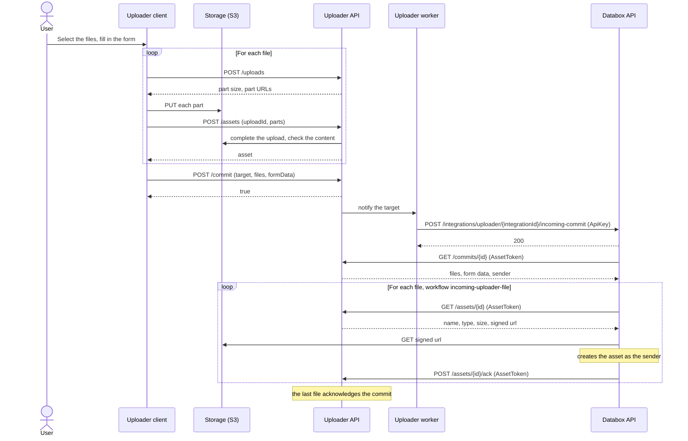
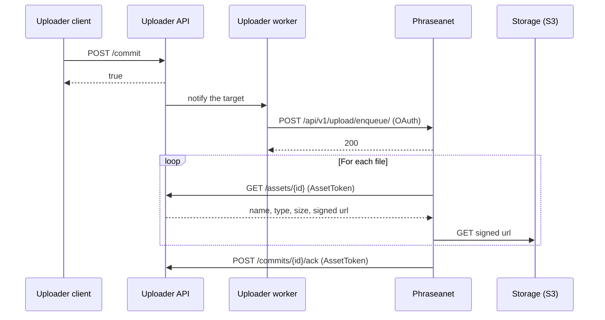
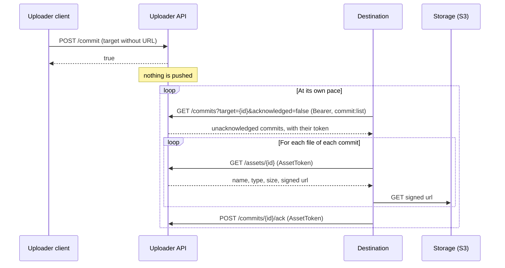

# Request Flow

An upload goes through three stages: the files are sent to the storage, the batch is committed, then the destination reads the files and acknowledges them. The destination is notified of the commit (push mode), or lists the commits itself (pull mode).

## Upload

1. The client creates a multipart upload per file (`POST /uploads`): the API answers the part size and the presigned URLs of the parts.
2. The browser sends the parts straight to S3, several at a time; the API never receives the content.
3. Once a file is sent, `POST /assets` (with the `uploadId` and the `ETag` of each part) completes the upload. The API checks the size and the content of the stored object, then records the asset. A file can also be sent in the request itself (`multipart/form-data`, `file` field), within `UPLOAD_MAX_FILE_SIZE`.
4. Once every file is recorded and the form is valid, `POST /commit` (`target`, `files`, `formData`) stores the commit right away, and queues the notification of the target.

The client sends the files while the user fills in the form. See [API reference](./api.md#commits) for the checks of the commit.

An import from a URL (`POST /downloads`) skips the first three steps: the worker downloads the file, then commits it alone (see [API reference](./api.md#imports-from-a-url)).

## Notification of the target

In push mode, the worker (`App\Consumer\Handler\AssetConsumerNotifyHandler`) sends:

```http
POST {targetUrl}
Authorization: {authorizationScheme} {authorizationKey}
Content-Type: application/json

{
    "assets": ["<asset id>", "<asset id>"],
    "publisher": "<user id of the sender>",
    "commit_id": "<commit id>",
    "token": "<token of the commit>",
    "base_url": "<UPLOADER_API_URL>"
}
```

- The scheme defaults to `ApiKey`. For a commit sent through an upload link, the publisher is the creator of the link.
- No request is sent when the target has no URL (pull mode) or when its key is `avoid`.
- The destination answers a 2xx within 60 seconds. Otherwise the message is retried by the worker, then kept with the failed messages of the admin.
- The request reaches the private network only for the origins of `DATABOX_API_URL` and `UPLOADER_TARGET_PRIVATE_ORIGINS`; to these origins, it does not follow redirections. See [Targets on the private network](./02_setup.md#targets-on-the-private-network).
- The notification is queued once per commit (`Commit::$notifyDispatchedAt`, `CommitNotifier::notifyOnce`): a retried `POST /commit` does not notify the target again, unless the first notification could not be queued. An admin can send it again with the "trigger again" action of the Commits (`CommitNotifier::notifyAgain`).

## Reading and acknowledging

The `token` of the notification is the credential of the destination for this commit only: `Authorization: AssetToken <token>`, on `base_url`.

- `GET /commits/{id}`: the commit, with its files (`assets`), its form data (`formData`), the language of the form (`formLocale`) and the sender (`userId`).
- `GET /assets/{id}`: a file, with its name, type, size and `url`, a signed URL of the storage valid for `UPLOADER_REQUEST_SIGNATURE_TTL` seconds. The content is read from this URL.
- `POST /assets/{id}/ack`: acknowledges one file. Acknowledging the last file of a commit acknowledges the commit.
- `POST /commits/{id}/ack`: acknowledges the commit and all its files at once.

The acknowledgements are processed by the worker. Once a commit is acknowledged, its sender is notified if they asked for it ("Notify me when done"), and its files are deleted (see [Retention and cleanup](./configuration.md#retention-and-cleanup)).

### Databox

Databox receives the notification on the `incoming-commit` URL of its Uploader integration, checks the key, then reads the commit. Each file is ingested by the `incoming-uploader-file` workflow, which downloads it, creates the asset and acknowledges the file.



### Phraseanet

Phraseanet receives the notification on its enqueue endpoint (`OAuth` scheme), then fetches the files with the token of the commit.



## Pull mode

A target without URL is never notified. The destination lists its commits with an access token carrying the `commit:list` scope (or of an admin): `GET /commits?target=<target id>&acknowledged=false`, the Pull mode URL shown in the admin plus the `acknowledged` filter. Each commit holds its `token`: the destination then reads and acknowledges its files as in push mode.



A commit that is never acknowledged keeps its files until `ASSET_DAYS_RETENTION` days have passed.

---

For more on the uploader setup and configuration, see [Uploader Setup](./02_setup.md) and [Uploader Configuration](./configuration.md).
